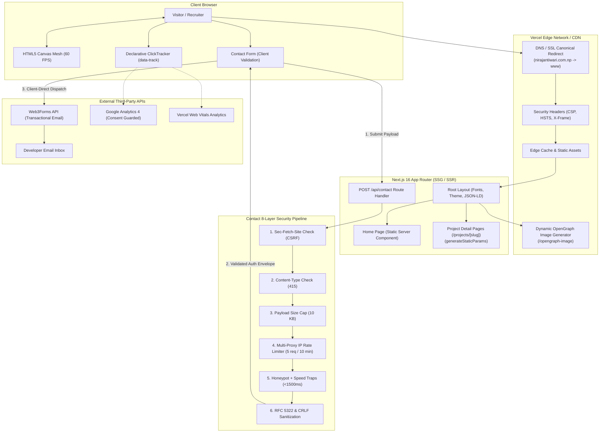

# Nirajan Tiwari - Full Stack Developer Portfolio

[](https://nextjs.org)
[](https://react.dev)
[](https://www.typescriptlang.org)
[](https://tailwindcss.com)
[](https://motion.dev)
[](https://nodejs.org)

A modern, high-performance developer portfolio and digital case-study platform built by **Nirajan Tiwari**. Engineered with the **Next.js 16 App Router**, **React 19**, **TypeScript**, and **Tailwind CSS v4**, this application delivers a cyber-dark aesthetic, deep technical project breakdowns, an interactive HTML5 Canvas 2D background, and an enterprise-grade 8-layer contact security workflow.

---

## Table of Contents

- [1. Project Overview](#1-project-overview)
- [2. Live Demo and Preview](#2-live-demo-and-preview)
- [3. Key Features](#3-key-features)
- [4. Technology Stack](#4-technology-stack)
- [5. Project Architecture](#5-project-architecture)
- [6. Project Directory Structure](#6-project-directory-structure)
- [7. Detailed Feature Implementation](#7-detailed-feature-implementation)
- [8. UI/UX and Design System](#8-uiux-and-design-system)
- [9. API and Third-Party Integrations](#9-api-and-third-party-integrations)
- [10. Environment Variables and Configuration](#10-environment-variables-and-configuration)
- [11. Installation and Local Development](#11-installation-and-local-development)
- [12. Available Scripts](#12-available-scripts)
- [13. Build and Production Deployment](#13-build-and-production-deployment)
- [14. SEO and Performance](#14-seo-and-performance)
- [15. Security Considerations](#15-security-considerations)
- [16. Testing and Quality Assurance](#16-testing-and-quality-assurance)
- [17. Browser and Device Compatibility](#17-browser-and-device-compatibility)
- [18. Known Limitations and Future Improvements](#18-known-limitations-and-future-improvements)
- [19. Contributing](#19-contributing)
- [20. License](#20-license)
- [21. Author and Contact](#21-author-and-contact)

---

## 1. Project Overview

### Purpose & Vision
The primary objective of this portfolio is to move beyond superficial bullet points and static resumes. It serves as an interactive engineering platform showcasing full-stack capabilities, system design philosophies, clean architectural patterns, and production-tested applications.

### Problems Addressed
- **Superficial Project Summaries**: Standard portfolios present brief descriptions without technical depth. This platform delivers multi-section, in-depth architectural case studies complete with problem-solution matrices, system data flows, database schemas, and engineering trade-offs.
- **Form Spam & Datacenter Blocks**: Contact forms on developer portfolios frequently suffer from automated bot spam or failure when serverless functions get blocked by third-party mail APIs. This project incorporates an 8-layer validation pipeline paired with a secure direct browser delivery fallback.
- **Heavy Asset Bloat**: Modern web apps often suffer high First Contentful Paint (FCP) and Cumulative Layout Shift (CLS) from unoptimized 3D libraries (Three.js/WebGL). This application uses an ultra-lightweight, native HTML5 Canvas 2D spatial particle mesh ($O(N \log N)$ distance pruning) running at a continuous 60 FPS without external dependencies.
- **Accessibility & Motion Fatigue**: Provides high-contrast dark cyber styling (WCAG AA/AAA compliant) while strictly honoring `prefers-reduced-motion` settings.

### Target Audience
- **Technical Recruiters & Engineering Hiring Managers**: Evaluating code quality, system design competence, and full-stack execution.
- **Software Architects & Senior Peers**: Reviewing clean separation of concerns, defensive programming patterns, and edge optimization.
- **Clients & Technical Stakeholders**: Reviewing verified credentials, real-world case studies, and initiating secure project inquiries.

### About the Developer
**Nirajan Tiwari** is a Full Stack Developer based in Kathmandu, Nepal. Currently completing his **B.Sc. CSIT** at Orchid International College (Affiliated with Tribhuvan University, 2022–2026), he has gained hands-on industry experience building scalable web solutions at **Cherdung Info Tech** and **Vyomite IT Services**. His core engineering competencies include Python (Django, FastAPI), React, Next.js, TypeScript, PostgreSQL, and RESTful API architecture.

---

## 2. Live Demo and Preview

| Resource | URL |
| :--- | :--- |
| **Production Website** | [https://www.nirajantiwari.com.np](https://www.nirajantiwari.com.np) |
| **Canonical Hostname** | `www.nirajantiwari.com.np` (apex domain `nirajantiwari.com.np` permanently 308-redirects to `www`) |
| **Source Repository** | [https://github.com/Nirajan09/portfolio-nextjs](https://github.com/Nirajan09/portfolio-nextjs) |
| **Open Graph Preview** | Dynamic Edge-generated 1200x630 cards at `https://www.nirajantiwari.com.np/opengraph-image` |
| **Project OG Previews** | Dynamic case-study OG previews at `/projects/[slug]/opengraph-image` |

---

## 3. Key Features

### 1. Responsive Cyber-Dark Landing Page
- **Hero Section**: Dynamic headline with cyclical typed role carousel (`TypingRole.tsx`), pulsating "Open to New Opportunities" live status beacon, direct PDF resume download CTA with click event tracking, and ambient glowing radial cyber grids.
- **About Section**: Interactive spotlight card with mouse-coordinate radial glow (`requestAnimationFrame`), live Kathmandu timezone clock (`Intl.DateTimeFormat` for `Asia/Kathmandu`, UTC+5:45) updated every 30 seconds, narrative background, and core technology badges.
- **Technical Skills Showcase**: Categorized grid (Frontend, Backend, Development Tools) with iconography, proficiency levels, and responsive hover highlights.
- **Projects Showcase**: Interactive category filtering ("All Projects", "Job Portal", "E-Commerce & ML", "Media Platform") utilizing Motion layout animations (`layoutId="activeFilterIndicator"`) with direct links to live deployments, GitHub repositories, and full case studies.
- **Career & Education Timeline**: Chronological, unified career timeline rendering industry experience (Cherdung Info Tech, Vyomite IT Services) alongside formal academic milestones (B.Sc. CSIT, +2 Science, SEE) with sticky side-navigation headers.
- **Verified Credentials & Certifications**: Grid of verified certificates (Broadway Infosys Python/Django, Udemy Django Masterclass) with direct credential verification links and preview modals.
- **Services & Capabilities**: Component (`components/sections/Services.tsx`) detailing Full-Stack Web Development, Backend & API Engineering, and Modern Frontend Architecture with deliverables, tooling, and communication channels.

### 2. Comprehensive Project Detail Pages (`/projects/[slug]`)
- Fully static generated routes (`generateStaticParams`, `dynamicParams = false`) for instant page loads.
- **Hero Showcase**: Project category, live status, quick link triggers, and high-resolution thumbnail.
- **In-Page Sticky Navigation**: Smooth-scrolling table of contents highlighting the active section during read-through.
- **Problem & Solution Matrix**: Clear breakdown of real-world problems solved and architectural approaches taken.
- **System Architecture & Data Flow**: Deep-dive explanation of client-server models, caching layers, and database relationships.
- **Key Features & Capabilities**: Bulleted technical specifications with performance benchmarks.
- **Grouped Technology Stack**: Frontend, Backend, Database, and DevOps tooling tags with version context.
- **Engineering Challenges & Technical Outcomes**: Real-world bugs, performance bottlenecks, and the technical solutions applied.
- **Previous/Next & Related Projects Navigation**: Seamless inter-case-study routing.

### 3. Fortified 8-Layer Contact System
- Dual-validation pipeline executing identical RFC-compliant schema validation on both client and server.
- Real-time validity indicators with animated checkmarks, interactive character countdown bars, and auto-focus error navigation.
- Multi-proxy rate limiting, double bot traps (honeypot + machine timing threshold), CRLF injection sanitization, and client-direct delivery fallback to eliminate serverless datacenter IP blocking.

### 4. Interactive Canvas 2D Particle Mesh
- Custom HTML5 Canvas 2D engine rendering 120 floating nodes with velocity vectors, edge deflection, and mouse repulsion/attraction.
- Axis-aligned 1D spatial sorting ($O(N \log N)$) enabling high-density particle networks at a rock-solid 60 FPS without WebGL overhead or mobile battery drain.

### 5. Zero-JS Declarative Event Tracking
- Event delegation pattern using HTML5 `data-track` attributes (`ClickTracker.tsx`). Captures interactions across the entire DOM without attaching client event listeners to Server Components.

---

## 4. Technology Stack

### Frontend Core
| Technology | Version | Purpose in Project |
| :--- | :--- | :--- |
| **Next.js** | `16.4.3` | React meta-framework utilizing the App Router, Static Site Generation (SSG), Edge Image generation, and Route Handlers. |
| **React** | `19.2.8` | UI library utilizing the latest React 19 concurrency, Server Components, and client hooks. |
| **React DOM** | `19.2.8` | DOM rendering and portal integration for modals. |
| **TypeScript** | `^5` | Strict static typing across domain data, component props, and API request/response contracts. |

### Styling & Animation
| Technology | Version | Purpose in Project |
| :--- | :--- | :--- |
| **Tailwind CSS** | `^4.1.18` | Next-generation utility-first styling engine running via `@tailwindcss/postcss`. |
| **Motion (`motion/react`)** | `^13.4.6` | Performant spring animations, layout transitions, and entrance effects. |
| **React Icons** | `^5.7.0` | Feather, Lucide, and Simple icon sets with tree-shaken imports. |
| **Google Fonts** | Native Next.js | Self-hosted, zero-layout-shift `Inter` (body) and `Space Grotesk` (display) font variables. |

### Backend & API
| Technology | Version | Purpose in Project |
| :--- | :--- | :--- |
| **Next.js Route Handlers** | `16.4.3` | `/api/contact` serverless endpoint enforcing security checks, rate limiting, and sanitization. |
| **Web3Forms API** | REST | External transactional email dispatch delivering contact inquiries directly to developer inbox. |

### Analytics & SEO
| Technology | Version | Purpose in Project |
| :--- | :--- | :--- |
| **@vercel/analytics** | `^1.6.1` | Real-time Core Web Vitals and visitor privacy-first metrics. |
| **@next/third-parties**| Built-in | Optimized Google Analytics 4 integration script loader. |
| **JSON-LD Engine** | Custom | Structured data generation for `Person`, `WebSite`, and `SoftwareApplication` schemas. |

### Development, Testing & Quality Assurance
| Technology | Version | Purpose in Project |
| :--- | :--- | :--- |
| **Node.js Test Runner** | `v18+ / v20+` | Built-in native test runner (`node --test`) for zero-dependency unit and security tests. |
| **ESLint** | `^9` | Flat-config linter paired with `eslint-config-next`. |
| **Prettier** | `^3.6.2` | Code formatting with `prettier-plugin-tailwindcss` class sorting. |

---

## 5. Project Architecture

The application adopts the **Next.js App Router hybrid architecture**:
1. **Static Shell & Server Components**: Core pages (`/` and `/projects/[slug]`) are pre-rendered at build time (SSG) with zero JavaScript footprint for static content.
2. **Client Component Islands**: Interactivity (Canvas mesh, contact form, modal previews, typing animations, spotlight cards) is scoped strictly to interactive leaf components marked with `"use client"`.
3. **Edge SEO & Metadata**: Dynamically generated Open Graph images (`@vercel/og`), XML sitemaps, and robots.txt are computed at the edge.
4. **Defensive API Gateway**: The contact route acts as a security barrier, validating and sanitizing payloads before passing an authorized authorization envelope back to the browser for Web3Forms dispatch.

### High-Level Architecture Diagram



---

## 6. Project Directory Structure

```text
portfolio-nextjs/
├── .env.example                     # Environment template with safe placeholders
├── .gitignore                       # Git ignore specifications
├── .prettierrc                      # Prettier code formatting rules
├── AGENTS.md                        # Next.js agent operational instructions
├── eslint.config.mjs                # ESLint configuration
├── next.config.ts                   # Next.js configuration (security headers & redirects)
├── package.json                     # Project manifest, dependencies, and scripts
├── postcss.config.mjs               # PostCSS configuration for Tailwind CSS v4
├── tsconfig.json                    # TypeScript compiler configuration
│
├── app/                             # Next.js App Router directory
│   ├── api/
│   │   └── contact/
│   │       └── route.ts             # 8-layer contact security Route Handler
│   ├── icons/
│   │   └── [size]/
│   │       └── route.tsx            # Dynamic multi-size PNG icon generator
│   ├── projects/
│   │   └── [slug]/
│   │       ├── opengraph-image.tsx  # Dynamic OG image per project
│   │       └── page.tsx             # Static case study page (dynamicParams = false)
│   ├── apple-icon.tsx               # Dynamic Apple Touch Icon
│   ├── globals.css                  # Tailwind v4 theme, design tokens, utility classes
│   ├── icon.tsx                     # Dynamic browser favicon
│   ├── layout.tsx                   # Root HTML shell, fonts, JSON-LD, global nav/footer
│   ├── manifest.ts                  # Web App Manifest generator
│   ├── not-found.tsx                # Custom 404 error page
│   ├── opengraph-image.tsx          # Dynamic site-wide Open Graph card
│   ├── page.tsx                     # Home landing page composition
│   ├── robots.ts                    # Dynamic robots.txt with indexing guards
│   ├── sitemap.ts                   # Dynamic XML sitemap generator
│   └── twitter-image.tsx            # Dynamic Twitter card image generator
│
├── components/                      # Modular UI component system
│   ├── analytics/                   # Analytics instrumentation
│   │   ├── Analytics.tsx            # Production/indexing conditional loader
│   │   ├── ClickTracker.tsx         # Delegated click listener for [data-track]
│   │   ├── GoogleAnalytics.tsx      # GA4 script injector
│   │   └── PageViewTracker.tsx      # Route change SPA page-view tracker
│   ├── animation/                   # Motion animation wrappers
│   │   ├── MotionConfig.tsx         # Global reduced-motion provider
│   │   ├── Reveal.tsx               # IntersectionObserver viewport reveal
│   │   ├── Stagger.tsx              # Staggered entrance orchestrator
│   │   └── TypingRole.tsx           # Continuous typewriter role cycling
│   ├── background/
│   │   └── InteractiveMesh.tsx      # High-performance 2D Canvas particle mesh
│   ├── certifications/
│   │   ├── CertificatePreview.tsx   # Lightbox modal for certificate viewing
│   │   └── CertificationCard.tsx    # Card with credential ID & verification links
│   ├── contact/
│   │   ├── ContactForm.tsx          # Form with real-time feedback & dual validation
│   │   └── ContactStatusModal.tsx   # Accessible success/error dialog portals
│   ├── experience/
│   │   └── CareerTimeline.tsx       # Chronological experience & education timeline
│   ├── layout/
│   │   ├── Footer.tsx               # Site footer with back-to-top & copyright
│   │   ├── Navbar.tsx               # Sticky nav with scroll progress indicator
│   │   ├── PageContainer.tsx        # Standardized responsive max-width wrapper
│   │   └── Section.tsx              # Semantic section container with anchor IDs
│   ├── projects/                    # Case study & project showcase components
│   │   ├── ProjectArchitectureSection.tsx # Architecture & system data flow
│   │   ├── ProjectCard.tsx          # Home project preview card
│   │   ├── ProjectChallengesSection.tsx   # Engineering hurdles & outcomes
│   │   ├── ProjectDetail.tsx        # Case study master template
│   │   ├── ProjectFeaturesSection.tsx     # Capabilities & specifications
│   │   ├── ProjectHero.tsx          # Project case study hero header
│   │   ├── ProjectNavigation.tsx    # Prev/Next & related projects footer
│   │   ├── ProjectOverviewSection.tsx     # Problem & solution matrix
│   │   ├── ProjectSectionNav.tsx    # Sticky in-page section jump nav
│   │   └── ProjectStackSection.tsx  # Categorized project tech tags
│   ├── sections/                    # Homepage section assemblies
│   │   ├── About.tsx                # About bio, live clock & mouse spotlight
│   │   ├── Certifications.tsx       # Certifications grid
│   │   ├── Contact.tsx              # Contact section container & direct info
│   │   ├── Experience.tsx           # Experience section container
│   │   ├── Hero.tsx                 # Hero section layout & action CTAs
│   │   ├── HeroPortrait.tsx         # Profile image with animated gradient ring
│   │   ├── Projects.tsx             # Projects section with category filter pills
│   │   ├── Services.tsx             # Standalone 3-column service capabilities
│   │   └── Skills.tsx               # Categorized skills matrix
│   └── ui/                          # Atomic, accessible design primitives
│       ├── Button.tsx               # Polymorphic button/anchor component
│       ├── Dialog.tsx               # Accessible modal overlay dialog
│       ├── IconButton.tsx           # Accessible icon button
│       ├── SectionHeading.tsx       # Standardized eyebrow, title, and subtitle
│       ├── ServiceCard.tsx          # Card displaying service specifications
│       ├── SkillCard.tsx            # Card displaying grouped skills
│       └── TechChip.tsx             # Compact badge for technologies
│
├── data/                            # Static, strongly typed domain models
│   ├── about.ts                     # Biography, highlights, and personal background
│   ├── certifications.ts            # Verified credentials, issuers, and verification URLs
│   ├── education.ts                 # Formal academic degrees and institutions
│   ├── experience.ts                # Professional work history and achievements
│   ├── navigation.ts                # Main header navigation item declarations
│   ├── personal.ts                  # Contact details, social links, and metadata
│   ├── projects.ts                  # Complete project case study content
│   ├── services.ts                  # Service capabilities and deliverables
│   └── skills.ts                    # Technical skill groups and proficiency levels
│
├── lib/                             # Utility libraries and helpers
│   ├── analytics.ts                 # GA4 event tracking helpers and data-track parser
│   ├── contact.ts                   # Validation rules, limits, and CRLF sanitizer
│   ├── seo.ts                      # JSON-LD structured data and metadata builders
│   └── utils.ts                    # Tailwind `cn` class merger (`clsx` + `tailwind-merge`)
│
├── public/                          # Static public assets
│   ├── Nirajan_Tiwari_Resume.pdf    # Official downloadable CV
│   └── profile.png                  # Developer portrait photo
│
├── scripts/                         # Operational & automated test scripts
│   └── test-contact-security.mjs    # 16-test automated security & API integration suite
│
├── tests/                           # Unit test suites
│   └── contact-unit.test.mjs        # 27 unit tests running via `node --test`
│
└── types/                           # Global TypeScript declarations
    └── index.ts                     # TypeScript interfaces (Project, Experience, Skill, etc.)
```

---

## 7. Detailed Feature Implementation

### 1. Contact Security Pipeline (`app/api/contact/route.ts`)
The contact endpoint implements an 8-stage defensive funnel:
1. **CSRF & Origin Gate**: Inspects `Sec-Fetch-Site`. If present and marked as `cross-site`, the request is immediately terminated with `403 Forbidden`.
2. **Strict Media Type Check**: Rejects any request whose `Content-Type` header is not strictly `application/json` (`415 Unsupported Media Type`), preventing simple-form CSRF exploits.
3. **Payload Memory Exhaustion Guard**: Reads raw chunks up to a strict limit of 10 KB ($10,240$ bytes). Payloads exceeding this threshold return `413 Payload Too Large`.
4. **Malformed JSON Handling**: Gracefully catches JSON parsing syntax exceptions, returning `400 Bad Request` without stack trace leakage.
5. **Multi-Proxy Rate Limiting**: Resolves client IP across Cloudflare (`cf-connecting-ip`), NGINX (`x-real-ip`), and multi-hop proxies (`x-forwarded-for`). An in-memory sliding window allows a maximum of 5 submissions per 10-minute window per IP. Breaches yield `429 Too Many Requests` with a `Retry-After` header.
6. **Honeypot Bot Trap**: Features an invisible field (`website`). If filled by automated scrapers, the endpoint silently returns a fake `200 OK` without performing any email dispatch.
7. **Speed Threshold Trap**: Verifies that time elapsed between form rendering and submission (`timeTakenMs`) is $\ge 1,500$ ms. Instantaneous bot scripts are absorbed with a silent `200 OK`.
8. **CRLF Injection Stripping & RFC 5322 Validation**: Strips all carriage returns (`\r`) and linefeeds (`\n`) from single-line fields (name, email, subject) using `stripCRLF`. Validates email addresses using strict RFC 5322 regex. Names must contain only Unicode letters, spaces, hyphens, and apostrophes.

#### Client-Side Direct Dispatch Architecture
When validation succeeds, the server does **not** make the outbound call to Web3Forms from the datacenter (which frequently gets blacklisted by shared cloud IP blocks). Instead, it returns an authorized payload with the sanitized data and access key back to the user's browser, which performs the final `POST` to Web3Forms directly from the user's residential/mobile connection.

### 2. High-Performance Canvas 2D Particle Mesh (`components/background/InteractiveMesh.tsx`)
Rather than pulling in heavy WebGL or Three.js dependencies (which add >500 KB to bundles), the particle network is implemented in native Canvas 2D:
- **Node Count**: 120 floating particles.
- **Physics**: Constant velocity displacement with edge boundary reflection ($v_x = -v_x$).
- **Interaction**: Calculates Euclidean distance from mouse position. If distance is $< 140$ px, particles accelerate away via an inverse-proportional repulsion vector:
  $$\vec{F} = \left(\frac{r - d}{r}\right) \cdot \hat{u}$$
- **Spatial Optimization**: Before connecting lines between particles, nodes are sorted along the X-axis ($O(N \log N)$). When comparing pairs, the inner loop breaks immediately as soon as $\Delta x > d_{\max}$, discarding distant particle pairs without calculating expensive square roots.

### 3. Dynamic Project Case Studies (`app/projects/[slug]/page.tsx`)
- Project routes are statically computed at build time via `generateStaticParams()`.
- Route segments set `export const dynamicParams = false`, returning automatic 404s for unregistered slugs without querying runtime handlers.
- Each project generates dedicated metadata and a customized Open Graph preview card containing the project's title, category, and tech stack.

### 4. Interactive Spotlight Effect (`components/sections/About.tsx`)
The primary card in the About section features a dynamic radial spotlight that follows the cursor:
- Tracks `clientX` and `clientY` relative to the bounding box via `useCallback`.
- Schedules updates via `requestAnimationFrame` to decouple mousemove events from paint cycles.
- Updates CSS custom properties `--mouse-x` and `--mouse-y` dynamically on the DOM element without triggering React state re-renders.

---

## 8. UI/UX and Design System

### Design Philosophy
The portfolio employs a **Cyber-Dark Obsidian** visual language: deep, neutral slate backgrounds paired with high-energy electric cyan and violet accents, evocative of modern developer tools, terminal interfaces, and high-performance engineering suites.

### Color Tokens (`app/globals.css`)
| Token | Value | Tailwind Role | Usage |
| :--- | :--- | :--- | :--- |
| `--background` | `#070b14` | `bg-background` | Deep obsidian page canvas background. |
| `--surface` | `#0c1322` | `bg-surface` | Card and container elevation layer. |
| `--surface-elevated` | `#111a2e` | `bg-surface-elevated` | Hover states, modals, and raised popovers. |
| `--border` | `#1e293b` | `border-border` | Subtle structural division lines (Slate 800). |
| `--border-accent` | `#334155` | `border-border-accent` | Highlighted borders and active interactive boundaries. |
| `--text-primary` | `#f1f5f9` | `text-primary` | High-contrast body and heading copy (Slate 100). |
| `--text-secondary` | `#94a3b8` | `text-secondary` | Descriptive subtitles and meta labels (Slate 400). |
| `--text-muted` | `#64748b` | `text-muted` | Captions, inactive dates, and placeholder text (Slate 500). |
| `--accent` | `#22d3ee` | `text-accent` / `bg-accent` | Electric cyan brand accent and focus rings. |
| `--accent-hover` | `#06b6d4` | `hover:bg-accent-hover` | Interactive hover state for accent controls. |
| `--blue` | `#3b82f6` | `bg-blue` | Complementary sapphire gradient accents. |
| `--violet` | `#8b5cf6` | `bg-violet` | Ambient atmospheric orb glows. |

### Typography
- **Display Headings**: `Space Grotesk` (weights 500, 600, 700) via `--font-space-grotesk` - technical, geometric, and modern.
- **Body & Tabular Data**: `Inter` (weights 400, 500, 600) via `--font-inter` - highly legible across all viewport sizes with tabular numeric alignment (`tabular-nums`) for clocks and counters.

### Accessibility (a11y)
- **Reduced Motion**: Encapsulated by `MotionConfig` and a global CSS media query:
  ```css
  @media (prefers-reduced-motion: reduce) {
    *, ::before, ::after {
      animation-duration: 0.01ms !important;
      transition-duration: 0.01ms !important;
    }
  }
  ```
- **Skip Navigation**: Accessible hidden skip link (`#main-content`) rendering immediately on keyboard focus.
- **Color Contrast**: All primary text satisfies WCAG AAA contrast ratios ($\ge 7:1$) against `#070b14`.
- **Keyboard Trapping**: Modals trap focus and bind `Escape` keys to close.

---

## 9. API and Third-Party Integrations

### 1. Web3Forms API
- **Purpose**: Serverless email relay dispatching contact form messages directly to developer inbox without maintaining private SMTP servers.
- **Workflow**: Contact form submits to local `/api/contact` -> Endpoint validates and returns access token -> Browser client executes `POST https://api.web3forms.com/submit`.
- **Configuration**: Requires `WEB3FORMS_ACCESS_KEY` in environment variables.

### 2. Google Analytics 4 (GA4)
- **Purpose**: Privacy-conscious tracking of page views and user engagement events.
- **Privacy Controls**: Automatically disabled in development environments. In production, it only activates if `NEXT_PUBLIC_ALLOW_INDEXING="true"` or if explicitly bypassed with `NEXT_PUBLIC_ENABLE_ANALYTICS_IN_DEV="true"`.
- **Configuration**: Requires `NEXT_PUBLIC_GA_MEASUREMENT_ID` (format: `G-XXXXXXXXXX`).

### 3. Vercel Analytics
- **Purpose**: Real-time performance tracking and Core Web Vitals monitoring.
- **Configuration**: Enabled when `NEXT_PUBLIC_VERCEL_ANALYTICS="true"`.

---

## 10. Environment Variables and Configuration

The application uses environment variables for third-party service connections and indexing policies. Create a `.env.local` file in the root directory:

### `.env.example`
```bash
# ==============================================================================
# Contact Form (Web3Forms)
# ==============================================================================
# Access key obtained from https://web3forms.com
# Required for contact form submissions.
WEB3FORMS_ACCESS_KEY=your_web3forms_access_key_here

# ==============================================================================
# Analytics Configuration
# ==============================================================================
# Google Analytics 4 Measurement ID (format: G-XXXXXXXXXX)
NEXT_PUBLIC_GA_MEASUREMENT_ID=G-XXXXXXXXXX

# Enable Vercel Web Analytics in production (set to "true" to activate)
NEXT_PUBLIC_VERCEL_ANALYTICS=false

# Force analytics to load in local development (default: false)
NEXT_PUBLIC_ENABLE_ANALYTICS_IN_DEV=false

# ==============================================================================
# Search Engine Indexing & Robots Policy
# ==============================================================================
# Controls robots.txt and meta robots tag ("true" for production, "false" for staging/preview)
NEXT_PUBLIC_ALLOW_INDEXING=true

# ==============================================================================
# Automated Testing Configuration
# ==============================================================================
# Base URL targeted by scripts/test-contact-security.mjs
TEST_URL=http://localhost:3000
```

### Variable Reference Table

| Variable Name | Required | Default / Format | Scope | Purpose |
| :--- | :---: | :--- | :--- | :--- |
| `WEB3FORMS_ACCESS_KEY` | **Yes** | UUID string | Server Route | Authorizes email delivery through Web3Forms. |
| `NEXT_PUBLIC_GA_MEASUREMENT_ID` | Optional | `G-[A-Z0-9]+` | Client / Browser | Google Analytics 4 stream measurement ID. |
| `NEXT_PUBLIC_VERCEL_ANALYTICS` | Optional | `"true"` / `"false"` | Client / Browser | Toggles Vercel Analytics tracking script. |
| `NEXT_PUBLIC_ENABLE_ANALYTICS_IN_DEV` | Optional | `"false"` | Client / Browser | Allows verifying analytics events on `localhost`. |
| `NEXT_PUBLIC_ALLOW_INDEXING` | Optional | `"true"` | Client / Server | Instructs web crawlers whether to index the site. |
| `TEST_URL` | Optional | `http://localhost:3000` | Node.js Test Runner | Base URL target for integration security tests. |

---

## 11. Installation and Local Development

### Prerequisites
- **Node.js**: `v18.18.0` or `v20.0.0+` (LTS recommended)
- **Package Manager**: `npm` (v9+), `pnpm` (v8+), or `yarn` (v1.22+)
- **Git**: Installed and configured

### Step-by-Step Setup

1. **Clone the Repository**
   ```bash
   git clone https://github.com/Nirajan09/portfolio-nextjs.git
   cd portfolio-nextjs
   ```

2. **Install Dependencies**
   ```bash
   npm install
   ```

3. **Configure Environment Variables**
   ```bash
   cp .env.example .env.local
   ```
   Open `.env.local` and add your `WEB3FORMS_ACCESS_KEY`.

4. **Start the Development Server**
   ```bash
   npm run dev
   ```

5. **Access the Application**
   Open your browser and navigate to `http://localhost:3000`.

---

## 12. Available Scripts

The following scripts are defined in `package.json`:

| Command | Action | Description |
| :--- | :--- | :--- |
| `npm run dev` | `next dev` | Launches the local Next.js development server with Fast Refresh. |
| `npm run build` | `next build` | Builds the optimized production application with static generation. |
| `npm run start` | `next start` | Runs the compiled production server locally. |
| `npm run lint` | `next lint` | Executes ESLint to check for code style issues and Next.js antipatterns. |
| `npm run typecheck` | `tsc --noEmit` | Executes TypeScript type-checking across all `.ts` and `.tsx` files. |
| `npm run test` | `npm run test:unit && npm run test:security` | Runs the full automated verification test suite. |
| `npm run test:unit` | `node --test tests/contact-unit.test.mjs` | Executes 27 native unit tests for validation, rate limiting, and sanitization. |
| `npm run test:security` | `node scripts/test-contact-security.mjs` | Runs 16 HTTP integration tests verifying endpoint defense layers. |

---

## 13. Build and Production Deployment

### Production Build
Execute the production build locally to verify static generation:
```bash
npm run build
```
This produces an optimized `.next` build output, compiling static HTML for `/`, `/projects/[slug]`, `/sitemap.xml`, and `/robots.txt`.

### Deployment to Vercel (Recommended)
1. Push your repository to GitHub.
2. Import the project in the [Vercel Dashboard](https://vercel.com).
3. Vercel automatically detects Next.js.
4. Add your environment variables (`WEB3FORMS_ACCESS_KEY`, `NEXT_PUBLIC_ALLOW_INDEXING="true"`).
5. Click **Deploy**.

### Canonical Domain & Redirects Configuration
Configured in `next.config.ts`:
```typescript
async redirects() {
  return [
    {
      source: "/:path*",
      has: [{ type: "host", value: "nirajantiwari.com.np" }],
      destination: "https://www.nirajantiwari.com.np/:path*",
      permanent: true,
    },
  ];
}
```
Any incoming request to apex `nirajantiwari.com.np` is permanently (HTTP 308) redirected to `www.nirajantiwari.com.np`, preserving SEO equity and link canonicalization.

---

## 14. SEO and Performance

### Technical SEO Implementation
- **Dynamic Sitemap**: Automatically generated at `/sitemap.xml` via `app/sitemap.ts`, indexing `/` and all project detail URLs with accurate `lastModified` timestamps.
- **Dynamic Robots**: Configured via `app/robots.ts`. Automatically disallows `/api/` from crawlers and respects `NEXT_PUBLIC_ALLOW_INDEXING`.
- **Dynamic Open Graph & Twitter Cards**: High-definition (1200x630) social sharing preview images rendered dynamically at the edge via `@vercel/og` (`app/opengraph-image.tsx` and `app/projects/[slug]/opengraph-image.tsx`).
- **Structured Data (JSON-LD)**: Injected in `<head>` via `JsonLd.tsx`:
  - `Person`: Full biographical details, job title, social profiles, and alumni institutions.
  - `WebSite`: Search configuration and author attribution.
  - `SoftwareApplication`: Per-project schema detailing application category and feature highlights.

### Performance Optimizations
- **Image Formats**: Configured in `next.config.ts` to prefer modern AVIF and WebP formats (`formats: ["image/avif", "image/webp"]`).
- **Console Stripping**: Production compiler configuration removes all `console.log` statements while preserving `console.error` and `console.warn`.
- **Package Import Optimization**: Experimental package tree-shaking enabled for `react-icons` and `motion` (`optimizePackageImports`).
- **Font Optimization**: Google Fonts (`Inter` and `Space Grotesk`) loaded using `next/font/google` with zero layout shift (CSS `size-adjust` fallback).
- **Framework Fingerprinting**: Disabled `x-powered-by` header (`poweredByHeader: false`).

---

## 15. Security Considerations

### 1. HTTP Security Headers
Every HTTP response is fortified with industry-standard headers configured in `next.config.ts`:
```typescript
const securityHeaders = [
  { key: "X-Content-Type-Options", value: "nosniff" },
  { key: "X-Frame-Options", value: "DENY" },
  { key: "Referrer-Policy", value: "strict-origin-when-cross-origin" },
  {
    key: "Permissions-Policy",
    value: "camera=(), microphone=(), geolocation=(), payment=(), usb=(), browsing-topics=()",
  },
  { key: "Cross-Origin-Opener-Policy", value: "same-origin" },
  { key: "Strict-Transport-Security", value: "max-age=63072000; includeSubDomains; preload" },
];
```

### 2. Cache Invalidation on Sensitive Endpoints
The `/api/:path*` route explicitly sets `Cache-Control: no-store` to prevent intermediary proxies or CDNs from caching sensitive contact requests.

### 3. Defensive Sanitization
All inputs are stripped of carriage returns and newlines before email composition to prevent SMTP header injection. Special HTML tags (`<script>`, `<iframe>`) are strictly blocked during schema validation.

---

## 16. Testing and Quality Assurance

The codebase includes automated unit and integration tests powered by the **Node.js native test runner** (`node --test`).

### 1. Unit Test Suite (`tests/contact-unit.test.mjs`)
Run with:
```bash
npm run test:unit
```
Covers **27 test assertions**:
- **CRLF Injection Prevention**: Verifies `\r` and `\n` stripping across multiple input configurations.
- **RFC 5322 Email Validation**: Rejects malformed addresses, header injection strings, and invalid domains.
- **Boundary Limit Enforcement**: Validates minimum/maximum length constraints for Name, Email, Subject, and Message.
- **Real-Time UI Indicator Accuracy**: Ensures the green confirmation checkmark never triggers prematurely on invalid inputs.
- **Rate Limiter Mechanics**: Tests sliding-window request throttling and per-IP boundary isolation.

### 2. Security Integration Suite (`scripts/test-contact-security.mjs`)
Run with a local server active:
```bash
npm run test:security
```
Tests all 8 security layers against HTTP status expectations (`403`, `415`, `413`, `400`, `429`, `200`).

---

## 17. Browser and Device Compatibility

| Browser | Supported Versions | Notes |
| :--- | :--- | :--- |
| **Google Chrome** | Latest 2 versions | Fully tested; Canvas 2D runs at 60 FPS. |
| **Mozilla Firefox** | Latest 2 versions | Full support; handles custom scrollbar and backdrop blurs. |
| **Apple Safari** | Latest 2 versions (macOS & iOS) | Full webkit prefix support; tested with dynamic viewport units. |
| **Microsoft Edge** | Latest 2 versions | Native Chromium performance. |

### Responsive Breakpoints
- **Mobile** (`< 640px`): Single-column layouts, touch-friendly tap targets ($\ge 44 \times 44$ px), mobile drawer menu.
- **Tablet** (`640px - 1023px`): Two-column project and certification grids.
- **Desktop** (`1024px - 1279px`): Sticky sidebar timeline navigation, multi-column feature layouts.
- **Large Display** (`\ge 1280px`): Full max-width page container constraints (`max-w-6xl` / `max-w-7xl`).

---

## 18. Known Limitations and Future Improvements

### Identified Limitations
- **In-Memory Rate Limiting**: The current rate limiter in `/api/contact` stores counters in serverless memory. Under distributed multi-region serverless scaling, rate limits are isolated per warm instance rather than globally synchronized.
- **Single Active Theme**: The user interface is intentionally locked to the cyber-dark palette (`colorScheme: "dark"`); no light theme toggle is currently provided.

### Future Architectural Roadmap
- [ ] **Distributed Rate Limiting**: Integrate Upstash Redis via `@upstash/ratelimit` for globally synchronized rate limiting across edge regions.
- [ ] **Adaptive Particle Density**: Adjust particle count dynamically using the Network Information API and Hardware Concurrency API (e.g., 60 nodes on low-power mobile, 120 on desktop).
- [ ] **Automated E2E Testing**: Add Playwright test suites for end-to-end user journeys (navigating case studies, submitting valid forms).

---

## 19. Contributing

Contributions, feedback, and issue reports are welcome.

1. **Fork the Repository** on GitHub.
2. **Create a Feature Branch**:
   ```bash
   git checkout -b feature/your-feature-name
   ```
3. **Commit Your Changes** following Conventional Commits:
   ```bash
   git commit -m "feat(ui): add new interactive case study diagram"
   ```
4. **Run Verification Commands**:
   ```bash
   npm run typecheck
   npm run lint
   npm run test:unit
   ```
5. **Push to Your Fork**:
   ```bash
   git push origin feature/your-feature-name
   ```
6. **Open a Pull Request** against the `main` branch.

---

## 20. License

No open-source license is granted for this repository. All rights are reserved by **Nirajan Tiwari**. 

The source code is published publicly for viewing, architectural inspection, and portfolio evaluation purposes. You may not distribute, reproduce, or claim commercial ownership of any portions of this codebase or its contents without explicit written permission.

---

## 21. Author and Contact

**Nirajan Tiwari**  
*Full Stack Developer*  
Kathmandu, Bagmati, Nepal

- **Website**: [https://www.nirajantiwari.com.np](https://www.nirajantiwari.com.np)
- **Email**: [nirajantiwari09@gmail.com](mailto:nirajantiwari09@gmail.com)
- **Phone**: [+977-9765973464](tel:+9779765973464)
- **LinkedIn**: [https://www.linkedin.com/in/nirajan-tiwari](https://www.linkedin.com/in/nirajan-tiwari)
- **GitHub**: [https://github.com/Nirajan09](https://github.com/Nirajan09)
- **Resume**: [Download Curriculum Vitae (PDF)](https://www.nirajantiwari.com.np/Nirajan_Tiwari_Resume.pdf)
