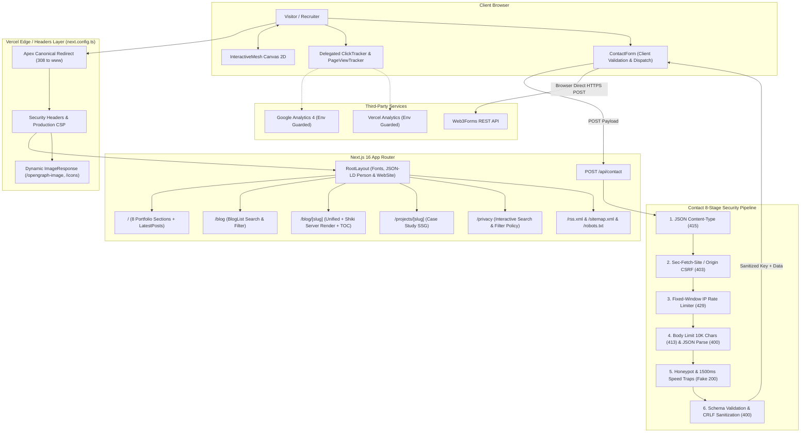

# Nirajan Tiwari — Full Stack Developer Portfolio

[](https://nextjs.org)
[](https://react.dev)
[](https://www.typescriptlang.org)
[](https://tailwindcss.com)
[](https://motion.dev)
[](https://nodejs.org)

A modern, high-performance developer portfolio, architectural case-study showcase, and technical engineering blog built by **Nirajan Tiwari**. Engineered with the **Next.js 16 App Router (Turbopack)**, **React 19**, **TypeScript**, and **Tailwind CSS v4**, featuring a cyber-dark design system, static Markdown + build-time Shiki blogging with RSS, a dedicated interactive privacy policy, a closure-isolated Canvas 2D backdrop, and an 8-layer defensive contact endpoint.

---

## Table of Contents

- [1. Project Overview](#1-project-overview)
- [2. Live Demo and Preview](#2-live-demo-and-preview)
- [3. Key Features](#3-key-features)
- [4. Technology Stack](#4-technology-stack)
- [5. Project Architecture](#5-project-architecture)
- [6. Project Directory Structure](#6-project-directory-structure)
- [7. Detailed Feature Implementation](#7-detailed-feature-implementation)
- [8. UI/UX and Design System](#8-uiux-and-design-system)
- [9. API and Third-Party Integrations](#9-api-and-third-party-integrations)
- [10. Environment Variables and Configuration](#10-environment-variables-and-configuration)
- [11. Installation and Local Development](#11-installation-and-local-development)
- [12. Available Scripts](#12-available-scripts)
- [13. Build and Production Deployment](#13-build-and-production-deployment)
- [14. SEO and Performance](#14-seo-and-performance)
- [15. Security Considerations](#15-security-considerations)
- [16. Testing and Quality Assurance](#16-testing-and-quality-assurance)
- [17. Browser and Device Compatibility](#17-browser-and-device-compatibility)
- [18. Known Limitations and Future Improvements](#18-known-limitations-and-future-improvements)
- [19. Contributing](#19-contributing)
- [20. License](#20-license)
- [21. Author and Contact](#21-author-and-contact)

---

## 1. Project Overview

### Purpose & Vision
This application moves beyond a static resume by combining verified architectural case studies, interactive service previews, engineering blog posts, and production-hardened serverless APIs into a single fast, statically generated web platform.

### Problems Addressed
- **Superficial Project Summaries**: Dedicated `/projects/[slug]` routes present full problem-solution matrices, system architecture layers, workflow steps, and engineering trade-offs.
- **Technical Knowledge Sharing Without Client JS Bloat**: A Git-versioned Markdown blog (`/blog` and `/blog/[slug]`) parses Markdown ASTs and runs VS Code-quality syntax highlighting purely at build time, shipping zero parser JavaScript to the browser while maintaining strict Content Security Policy (CSP) compliance.
- **Contact Spam & Cloud IP Blocking**: The `/api/contact` handler enforces an 8-stage defense pipeline (CSRF, body cap, IP rate limiting, honeypot, timing check, schema + CRLF sanitization) paired with browser-direct Web3Forms dispatch to avoid cloud IP anti-bot blocks.
- **Heavy WebGL Backdrop Overhead**: Uses a native Canvas 2D backdrop (`InteractiveMesh`) with pre-rendered radial glow sprites and closure-isolated state rather than heavy WebGL/Three.js bundles.
- **Accessibility & Motion Sensitivity**: High-contrast dark theme tokens with skip navigation, keyboard-accessible dialogs, and full `prefers-reduced-motion` support.

### Target Audience
- **Technical Recruiters & Engineering Hiring Managers** evaluating architectural judgment, full-stack execution, and written communication.
- **Software Engineers & Senior Peers** reviewing modular Server/Client boundaries, security defense layers, and system design write-ups.
- **Clients & Technical Stakeholders** exploring service capabilities and initiating direct project inquiries.

### About the Developer
**Nirajan Tiwari** is a Full Stack Developer based in Kathmandu, Nepal, pursuing a **B.Sc. in CSIT** at Orchid International College (affiliated with Tribhuvan University, 2022–2026) with industry experience at **Cherdung Info Tech** and **Vyomite IT Services**. His core stack centers on Python (Django, FastAPI), React, Next.js, TypeScript, Node.js, PostgreSQL, and MongoDB.

---

## 2. Live Demo and Preview

| Resource | URL |
| :--- | :--- |
| **Production Website** | [https://www.nirajantiwari.com.np](https://www.nirajantiwari.com.np) |
| **Canonical Redirect** | `nirajantiwari.com.np` -> `https://www.nirajantiwari.com.np` (HTTP 308 permanent redirect) |
| **Source Repository** | [https://github.com/Nirajan09/portfolio](https://github.com/Nirajan09/portfolio) |
| **Blog Archive & RSS** | `/blog` and `/rss.xml` |
| **Privacy Policy** | `/privacy` |
| **Dynamic Open Graph Cards** | `/opengraph-image`, `/projects/[slug]/opengraph-image`, and `/blog/[slug]/opengraph-image` |

---

## 3. Key Features

### 1. Landing Page Sections (`app/page.tsx`)
The home route composes 8 landing sections cleanly inside Server and Client boundaries:
- **Hero (`Hero.tsx`, `HeroPortrait.tsx`, `TypingRole.tsx`)**: Ambient cyber grid, availability status beacon, cyclical role typing animation, resume download CTA, social links, and portrait frame.
- **About (`About.tsx`)**: Mouse-tracked radial spotlight card (`requestAnimationFrame`), live Kathmandu timezone clock (`Asia/Kathmandu`, UTC+5:45), core technology chips, and highlight tiles (role, B.Sc. CSIT, location, outside technology interests: workouts, travelling & sports).
- **Technical Skills (`Skills.tsx`, `SkillCard.tsx`)**: Categorized Frontend, Backend, and Tools matrix.
- **Projects (`Projects.tsx`, `ProjectCard.tsx`)**: Interactive category filtering (`layoutId="activeFilterIndicator"`), skeleton image loading (`ImageWithSkeleton.tsx`), live demo and GitHub repo links, plus deep-dive case study routes.
- **Experience & Education (`Experience.tsx`, `CareerTimeline.tsx`)**: Unified timeline merging industry roles and academic milestones alongside a sticky left heading column.
- **Certifications (`Certifications.tsx`, `CertificationCard.tsx`, `CertificatePreview.tsx`)**: Verified credentials with preview modal lightbox and credential verification links.
- **Latest Articles (`LatestPosts.tsx`)**: Homepage writing showcase displaying featured posts with quick links to `/blog` and `/rss.xml`.
- **Contact (`Contact.tsx`, `ContactForm.tsx`, `ContactStatusModal.tsx`)**: Dual-validated inquiry form with real-time valid-field checkmarks, character counter bar, and accessible success/error status modals.
- *(Standalone Component)* **Services (`components/sections/Services.tsx` & `services/*`)**: Pre-built interactive service cards and visual sandboxes (`FullStackSandbox`, `FrontendSandbox`, `BackendSandbox`, `BusinessSandbox`).

### 2. Technical Blog & RSS System (`/blog`, `/blog/[slug]`, `/rss.xml`)
- **File-Based Markdown Authoring (`content/blog/*.md`)**: YAML frontmatter parsed via `gray-matter` with build-time word-count reading time calculation and `draft: true` filtering in production.
- **Interactive Blog Index (`/blog`)**: Live keyword search across titles, summaries, categories, and tags alongside animated category filter pills (`BlogList.tsx`) and live result counts.
- **Zero-Runtime Markdown + Shiki Reader (`/blog/[slug]`)**: Compiles Markdown AST -> HAST -> React 19 Server Component JSX via `unified`, `remark-gfm`, `rehype-slug`, `shiki/bundle/web`, and `hast-util-to-jsx-runtime`. Supports filename headers, copyable `<CodeBlock>` snippets, responsive tables, anchor headings, Prev/Next pagination, related post matching, and copy/native share controls.
- **Sticky Table of Contents (`BlogTableOfContents.tsx`)**: Auto-extracted `h2`/`h3` headings using `rehype-slug` IDs with `IntersectionObserver` scroll-spy highlighting.
- **RSS 2.0 Feed & Blog OG Cards**: Static `/rss.xml` feed with HTML `<link rel="alternate">` discovery and auto-generated per-post `1200x630` Open Graph cards.

### 3. Dedicated Interactive Privacy Policy (`/privacy`)
- Standalone SSR/SSG privacy page (`components/privacy/PrivacyContent.tsx`) replacing the legacy modal dialog.
- Features real-time topic search, category filter pills (*All Topics*, *Contact Form*, *Cookies & Analytics*, *Hosting & Logs*, *Your Rights*), mouse-spotlight trust pillars, copyable section anchors, copy-email feedback, and Print/PDF support.
- Explicitly documents Web3Forms and Vercel data processing, IP usage for rate limiting and security, analytics/cookie behavior, retention schedules, international transfers, GDPR/CCPA rights, and under-16 exclusions.

### 4. Comprehensive Project Case Studies (`/projects/[slug]`)
- Statically generated routes (`generateStaticParams`, `dynamicParams = false`) with `loading.tsx` skeleton fallback, sticky in-page section nav, Overview/Problem/Solution matrix, Architecture layers, Challenges & Outcomes, Workflow steps, and Prev/Next + Related navigation.

### 5. Closure-Isolated Canvas 2D Backdrop (`InteractiveMesh.tsx`)
- Deterministic seeded (`mulberry32`) particle network using pre-rendered `48x48` offscreen radial-gradient sprites (`createGlowSprite`), responsive node budgets (`45` / `70` / `120`), pointer repulsion within `150 px`, `visibilitychange` pausing, DPR capping (`<= 2`), and zero React re-renders.

### 6. Declarative Zero-JS Click Tracking (`ClickTracker.tsx`, `PageViewTracker.tsx`)
- Global click delegation reads `data-track` and `data-track-*` attributes without wiring client handlers into Server Components, while `PageViewTracker` fires SPA transitions (`page_view`, `project_view`, `blog_view`).

---

## 4. Technology Stack

### Core Framework & Language
| Technology | Package Version | Purpose in Project |
| :--- | :--- | :--- |
| **Next.js** | `16.4.3` | App Router, Static Site Generation (SSG), Edge `ImageResponse` generation, Route Handlers, CSP/security headers, and canonical redirects. |
| **React & React DOM** | `19.2.8` | Server Components, Client Component islands, and JSX runtime rendering. |
| **TypeScript** | `^5` | Strict static typing across domain models, component contracts, and API validation. |

### Styling, Animation & UI
| Technology | Package Version | Purpose in Project |
| :--- | :--- | :--- |
| **Tailwind CSS** | `^4` (`@tailwindcss/postcss`) | CSS-variable design tokens and utility classes in `app/globals.css`. |
| **Motion (`motion/react`)** | `^13.4.6` | Reduced-motion-aware viewport reveals, staggered entrances, and pill `layoutId` transitions. |
| **React Icons** | `^5.7.0` | Tree-shaken Lucide (`lu`) and Simple Icons (`si`) sets (`optimizePackageImports`). |
| **Google Fonts** | `next/font/google` | Self-hosted `Inter` (body) and `Space Grotesk` (display) with `display: "swap"`. |

### Blog Markdown & Syntax Pipeline
| Technology | Package Version | Purpose in Project |
| :--- | :--- | :--- |
| **gray-matter** | `^4.0.3` | Extracts YAML frontmatter and Markdown content on the server. |
| **unified / remark-parse / remark-gfm** | `^11.0.5` / `^11.0.0` / `^4.0.1` | Parses GitHub-Flavored Markdown (tables, lists, code fences) into AST. |
| **remark-rehype & rehype-slug** | `^11.1.2` / `^6.0.0` | Transforms MDAST to HAST and generates deterministic heading anchor `id` attributes. |
| **shiki (`shiki/bundle/web`)** | `^4.6.0` | Build-time syntax highlighting using `github-dark-default` with zero client JS shipped. |
| **hast-util-to-jsx-runtime** | `^2.3.7` | Converts highlighted HAST nodes directly to React 19 JSX elements (no `dangerouslySetInnerHTML` or `eval`). |

### API, Analytics & Tooling
| Technology | Package Version | Purpose in Project |
| :--- | :--- | :--- |
| **Web3Forms API** | External REST | Email relay receiving browser-direct contact submissions. |
| **@vercel/analytics** | `^2.0.1` | Optional privacy-friendly aggregated analytics in production. |
| **Google Analytics 4** | Custom `next/script` | Optional GA4 loader (`lazyOnload`) gated behind indexing/env checks. |
| **Node.js Test Runner** | Built-in (`node --test`) | Native unit and HTTP integration test execution without external test frameworks. |
| **ESLint** | `^9` | Flat config with `eslint-config-next/core-web-vitals` and `typescript`. |

---

## 5. Project Architecture

The application follows a **Server-First Static Hybrid Architecture** under Next.js 16 App Router:

1. **Static Prerendering (SSG)**: Home (`/`), `/blog`, `/blog/[slug]`, `/projects/[slug]`, `/privacy`, `/rss.xml`, `/sitemap.xml`, and OG images render into static artifacts at build time.
2. **Client Islands**: Interactive leaves (`Navbar`, `InteractiveMesh`, `ContactForm`, `BlogList`, `BlogTableOfContents`, `PrivacyContent`) carry `"use client"` boundaries cleanly separated from data fetching and Markdown compilation.
3. **API Security Gateway**: `/api/contact` validates headers, rate-limits IPs in memory, traps bots, sanitizes strings, and passes an authorized envelope back to the browser for Web3Forms submission.



---

## 6. Project Directory Structure

```text
portfolio-nextjs/
├── .env.example                           # Environment variable template with safe placeholders
├── .gitignore                             # Git ignore rules
├── AGENTS.md / CLAUDE.md                  # Next.js agent development instructions
├── eslint.config.mjs                      # Flat ESLint configuration (next/core-web-vitals + ts)
├── next.config.ts                         # CSP, security headers, image formats, canonical redirect
├── package.json                           # Dependencies and npm scripts
├── postcss.config.mjs                     # PostCSS pipeline with @tailwindcss/postcss
├── tsconfig.json                          # Strict TypeScript compiler config
│
├── content/
│   └── blog/                              # Markdown blog posts with YAML frontmatter
│       ├── 8-layer-contact-api-nextjs.md
│       └── high-fps-canvas-particle-mesh.md
│
├── app/                                   # Next.js 16 App Router routes & metadata routes
│   ├── api/contact/route.ts               # POST /api/contact defensive validation route
│   ├── blog/
│   │   ├── page.tsx                       # /blog listing route
│   │   └── [slug]/
│   │       ├── opengraph-image.tsx        # Dynamic per-article OG image
│   │       └── page.tsx                   # Static article reader (dynamicParams = false)
│   ├── icons/[size]/route.tsx             # Dynamic PNG icon endpoint (192, 512)
│   ├── privacy/page.tsx                   # Dedicated interactive Privacy Policy page
│   ├── projects/[slug]/
│   │   ├── loading.tsx                    # Skeleton loading UI for project routes
│   │   ├── opengraph-image.tsx            # Dynamic per-project OG image
│   │   └── page.tsx                       # Static case study page (dynamicParams = false)
│   ├── rss.xml/route.ts                   # Static RSS 2.0 XML feed
│   ├── apple-icon.tsx                     # Apple Touch icon route
│   ├── globals.css                        # Tailwind v4 design tokens, keyframes, scrollbar styles
│   ├── icon.tsx                           # Dynamic site favicon route
│   ├── layout.tsx                         # Root layout, Google fonts, JSON-LD, analytics, nav/footer
│   ├── manifest.ts                        # Web app manifest
│   ├── not-found.tsx                      # Custom 404 route
│   ├── opengraph-image.tsx                # Default site OG card
│   ├── page.tsx                           # Homepage composition
│   ├── robots.ts                          # Dynamic robots.txt
│   └── sitemap.ts                         # Dynamic XML sitemap (/, /blog, /privacy, posts, projects)
│
├── components/
│   ├── analytics/                         # Analytics.tsx, ClickTracker.tsx, GoogleAnalytics.tsx, PageViewTracker.tsx
│   ├── animation/                         # MotionConfig.tsx, Reveal.tsx, Stagger.tsx, TypingRole.tsx
│   ├── background/InteractiveMesh.tsx     # Canvas 2D sprite-cached particle mesh
│   ├── blog/                              # BlogCard, BlogList, BlogNavigation, BlogShareCopy,
│   │                                      # BlogTableOfContents, CodeBlock, CopyCodeButton, MarkdownContent
│   ├── certifications/                    # CertificatePreview.tsx, CertificationCard.tsx
│   ├── contact/                           # ContactForm.tsx, ContactStatusModal.tsx
│   ├── experience/CareerTimeline.tsx      # Unified career & education timeline
│   ├── layout/                            # Footer, Navbar, NotFoundContent, PageContainer, Section
│   ├── privacy/PrivacyContent.tsx         # Interactive privacy search/filter/copy page UI
│   ├── projects/                          # ProjectDetail, ProjectHero, ProjectCover, ProjectTabs,
│   │                                      # ProjectNavigation, ProjectSectionNav, & detail sections
│   ├── sections/                          # About, Certifications, Contact, Experience, Hero,
│   │   ├── services/                      # BackendSandbox, BusinessSandbox, FrontendSandbox, FullStackSandbox
│   │   └── ...                            # HeroPortrait, LatestPosts, Projects, Services, Skills
│   ├── seo/JsonLd.tsx                     # JSON-LD script renderer
│   └── ui/                                # Badge, Button, Card, IconButton, ImageWithSkeleton,
│                                          # SectionHeading, ServiceCard, Skeleton, SkillCard, TechChip, icons
│
├── data/                                  # Strongly typed static content modules
│   ├── about.ts, certifications.ts, education.ts, experience.ts,
│   └── navigation.ts, personal.ts, projects.ts, services.ts, skills.ts
│
├── lib/                                   # Shared server & client utilities
│   ├── analytics.ts                       # Typed AnalyticsEvent emitter & data-track parser
│   ├── blog.ts                            # Markdown/frontmatter loader, TOC extractor, Shiki highlighter
│   ├── brand.tsx                          # BrandMark & OgCard shared by OG & icon routes
│   ├── contact.ts                         # Shared RFC 5322 validation & CRLF sanitization
│   ├── rate-limit.ts                      # Fixed-window in-memory IP limiter
│   ├── readTime.ts                        # Read-time estimator for project case studies
│   ├── send-contact-email.ts              # Client Web3Forms fetch helper
│   ├── seo.ts                             # siteConfig, pageMetadata, Person/WebSite/Software/BlogPosting JSON-LD
│   └── utils.ts                           # Class concatenation helper
│
├── public/                                # Static local assets (CSP 'self' safe)
│   ├── Nirajan_Tiwari_Resume.pdf
│   ├── profile.png & profile_original_beach.png
│   ├── certificates/                      # Certificate images
│   └── projects/                          # Project preview screenshots
│
├── scripts/test-contact-security.mjs      # Live HTTP integration tests against /api/contact
├── tests/contact-unit.test.mjs            # 27 unit tests via node --test
└── types/index.ts                         # Domain TypeScript types (Project, BlogPost, Experience, etc.)
```

---

## 7. Detailed Feature Implementation

### 1. Contact Security Pipeline (`app/api/contact/route.ts` & `lib/rate-limit.ts`)
Each `POST /api/contact` call runs through 8 ordered checks before issuing a Web3Forms dispatch envelope:
1. **Media Type Enforcement**: Rejects non-JSON submissions (`415 Unsupported Media Type`) to neutralize simple HTML form CSRF attacks.
2. **Same-Origin Enforcement**: Inspects `sec-fetch-site === "same-origin"` or falls back to strict `origin` vs. `host` comparison (`403 Forbidden`).
3. **Fixed-Window IP Rate Limiter (`lib/rate-limit.ts`)**: Extracts client IP (`cf-connecting-ip`, `x-real-ip`, `x-forwarded-for`), limiting to **5 requests per 10-minute window** (`429 Too Many Requests` with `Retry-After` header) and opportunistically cleaning expired entries when `hits.size > 500`.
4. **Payload Cap**: Rejects raw bodies exceeding `10,000` characters (`413 Payload Too Large`).
5. **Malformed JSON Guard**: Catches `JSON.parse` errors cleanly (`400 Bad Request`).
6. **Honeypot Trap**: If hidden field `website` is non-empty, returns a silent fake `200 OK` without proceeding.
7. **Timing Trap**: Rejects automated submissions completed faster than `1,500 ms` silently with `200 OK`.
8. **Shared Schema & CRLF Sanitization (`lib/contact.ts`)**: Strips `\r` and `\n`, enforces RFC 5322 email syntax and Unicode letter rules, then hands the sanitized payload + key back to the browser (`ContactForm.tsx`) via `send-contact-email.ts` for direct Web3Forms dispatch, mitigating datacenter IP blocks.

### 2. Static Markdown + Shiki Blog Pipeline (`lib/blog.ts` & `components/blog/MarkdownContent.tsx`)
- Markdown files live in `content/blog/<slug>.md` with validated `[a-z0-9-]+` slugs.
- React `cache()` wraps `getAllPostsMeta`, `compileMarkdown`, and `getPostBySlug` to deduplicate file reads across `generateStaticParams`, `generateMetadata`, `sitemap.ts`, and page rendering.
- `unified` parses GFM Markdown, generates heading anchors via `rehype-slug`, extracts `h2`/`h3` items directly from the HAST AST so TOC links always match DOM IDs, highlights fenced code blocks statically via `shiki/bundle/web` (`github-dark-default`, falling back gracefully to `"text"`), and renders JSX cleanly via `hast-util-to-jsx-runtime` without `dangerouslySetInnerHTML` or runtime JS bloat.
- `<a href>` sanitization blocks unsafe URI protocols (only `https://`, `http://`, `/`, `#` are rendered as interactive links).

### 3. Closure-Isolated Canvas 2D Mesh (`components/background/InteractiveMesh.tsx`)
- **Zero React Re-renders**: Node coordinates, velocities, pointer coordinates, and `requestAnimationFrame` handles stay completely inside a `useEffect` closure.
- **Pre-rendered Radial Glow Sprites**: Rather than calling `ctx.createRadialGradient` on every frame, `createGlowSprite` caches three `48x48` offscreen canvases at mount time and blits them via `ctx.drawImage`.
- **Adaptive Density & Reduced Motion**: Scales max node budgets (`45` < 640px, `70` < 1024px, `120` desktop), clamps DPR to `<= 2`, uses squared-distance checks to skip distant links before `Math.sqrt`, pauses via `visibilitychange` when backgrounded, and draws a static frame when `prefers-reduced-motion: reduce` matches.

---

## 8. UI/UX and Design System

### Color Tokens (`app/globals.css`)
| CSS Variable | Value | Role |
| :--- | :--- | :--- |
| `--background` | `#070b14` | Primary deep obsidian page canvas |
| `--background-secondary` | `#0b1120` | Secondary surface backdrop and code containers |
| `--surface` | `#0f172a` | Cards, panels, and navbar container (`Slate 900`) |
| `--surface-elevated` | `#111827` | Elevated popovers and inline code pills (`Gray 900`) |
| `--border` | `#1e293b` | Structural dividers and card strokes (`Slate 800`) |
| `--text-primary` | `#f1f5f9` | Primary headings and emphasized copy (`Slate 100`) |
| `--text-secondary` | `#cbd5e1` | Body prose and card summaries (`Slate 300`) |
| `--text-muted` | `#9fb0c7` | Captions, dates, read times, and subtle labels |
| `--accent` / `--accent-hover` | `#22d3ee` / `#06b6d4` | Electric cyan interactive highlights & focus rings |
| `--blue` / `--violet` | `#3b82f6` / `#8b5cf6` | Complementary gradient beams and backdrop glows |
| `--success` / `--error` / `--warning` | `#22c55e` / `#ef4444` / `#f59e0b` | Validation, error states, and draft badges |

### Typography & Accessibility
- **Fonts**: `Space Grotesk` (`--font-space-grotesk`, weights 500/600/700) for headings, `Inter` (`--font-inter`, weights 400/500/600) for prose, paired with custom gradient scrollbars and accent text `::selection`.
- **Accessibility**: `#main-content` skip link in `app/layout.tsx`, `2px solid var(--accent)` `:focus-visible` outlines, semantic ARIA landmarks, keyboard `Escape` + backdrop traps in dialogs, and global `@media (prefers-reduced-motion: reduce)` CSS + `MotionConfig` overrides.

---

## 9. API and Third-Party Integrations

1. **Web3Forms (`https://api.web3forms.com/submit`)**: Processes and emails contact form submissions dispatched from the browser after `/api/contact` verification; requires `WEB3FORMS_ACCESS_KEY`.
2. **Vercel Analytics (`@vercel/analytics/next`)**: Optional aggregated visitor metrics, enabled only when `NEXT_PUBLIC_VERCEL_ANALYTICS="true"` in production (or `NEXT_PUBLIC_ENABLE_ANALYTICS_IN_DEV="true"` locally).
3. **Google Analytics 4 (`components/analytics/GoogleAnalytics.tsx`)**: Optional `gtag.js` script injected with `strategy="lazyOnload"` when `NEXT_PUBLIC_GA_MEASUREMENT_ID` matches `^G-[A-Z0-9]+$` and indexing is permitted.

---

## 10. Environment Variables and Configuration

Copy `.env.example` to `.env.local`:

```bash
# Access key from https://web3forms.com (Required for contact submissions)
WEB3FORMS_ACCESS_KEY=your_web3forms_access_key_here

# Optional analytics (disabled unless configured)
NEXT_PUBLIC_GA_MEASUREMENT_ID=G-XXXXXXXXXX
NEXT_PUBLIC_VERCEL_ANALYTICS=false
NEXT_PUBLIC_ENABLE_ANALYTICS_IN_DEV=false

# Search indexing policy ("true" in production)
NEXT_PUBLIC_ALLOW_INDEXING=true

# Target base URL for scripts/test-contact-security.mjs
TEST_URL=http://localhost:3000
```

| Variable | Required | Scope | Purpose |
| :--- | :---: | :--- | :--- |
| `WEB3FORMS_ACCESS_KEY` | **Yes** | Server Route (`/api/contact`) | Authorizes Web3Forms submission relay (also accepts `NEXT_PUBLIC_WEB3FORMS_ACCESS_KEY` fallback). |
| `NEXT_PUBLIC_GA_MEASUREMENT_ID` | Optional | Client | GA4 measurement ID (`G-...`). Automatically stripped from CSP when unset. |
| `NEXT_PUBLIC_VERCEL_ANALYTICS` | Optional | Client | Activates `@vercel/analytics/next` when `"true"`. |
| `NEXT_PUBLIC_ENABLE_ANALYTICS_IN_DEV` | Optional | Client | Forces analytics rendering during `next dev` verification. |
| `NEXT_PUBLIC_ALLOW_INDEXING` | Optional | Server/Client | Controls robots indexing eligibility alongside `VERCEL_ENV`. |
| `TEST_URL` | Optional | Test Script | Target server origin for `npm run test:security`. |

---

## 11. Installation and Local Development

1. **Prerequisites**: Node.js `v20+` (required by `shiki` engine), `npm` `v9+`, Git.
2. **Clone & Install**:
   ```bash
   git clone https://github.com/Nirajan09/portfolio.git
   cd portfolio
   npm install
   ```
3. **Configure Environment**:
   ```bash
   cp .env.example .env.local
   ```
   Set `WEB3FORMS_ACCESS_KEY` inside `.env.local` to enable live form submissions.
4. **Run Development Server**:
   ```bash
   npm run dev
   ```
   Open [http://localhost:3000](http://localhost:3000) in your browser. *(Draft blog posts with `draft: true` are visible locally in dev mode and excluded automatically in production builds.)*

---

## 12. Available Scripts

| Command | Underlying Command | Purpose |
| :--- | :--- | :--- |
| `npm run dev` | `next dev` | Starts local development server with Turbopack Fast Refresh. |
| `npm run build` | `next build` | Compiles production bundle, runs TypeScript check, and statically prerenders routes. |
| `npm run start` | `next start` | Serves the compiled `.next` production build locally. |
| `npm run lint` | `eslint` | Runs flat-config ESLint checks across project source files. |
| `npm run typecheck` | `tsc --noEmit` | Runs full TypeScript static type validation. |
| `npm run test` | `node --test tests/contact-unit.test.mjs && node scripts/test-contact-security.mjs` | Runs unit tests followed by live HTTP security integration tests. |
| `npm run test:unit` | `node --test tests/contact-unit.test.mjs` | Executes 27 isolated unit tests for validation, sanitization, and rate limiting. |
| `npm run test:security` | `node scripts/test-contact-security.mjs` | Tests `/api/contact` defense layers against a running server at `TEST_URL`. |

---

## 13. Build and Production Deployment

- **Production Build**: Running `npm run build` outputs a verified static + serverless build in `.next/`, pre-generating `/`, `/blog`, `/blog/[slug]`, `/blog/[slug]/opengraph-image`, `/projects/[slug]`, `/projects/[slug]/opengraph-image`, `/privacy`, `/rss.xml`, `/sitemap.xml`, `/robots.txt`, and dynamic icons, with `/api/contact` deployed as an on-demand serverless route.
- **Hosting (Vercel)**: Deploy directly from GitHub to Vercel, configure `WEB3FORMS_ACCESS_KEY` and optional analytics environment variables, and assign `www.nirajantiwari.com.np` + apex `nirajantiwari.com.np` (which automatically 308-redirects to `www` via `next.config.ts`).

---

## 14. SEO and Performance

- **Dynamic Sitemap & Robots**: `app/sitemap.ts` indexes `/`, `/blog`, `/privacy`, all projects, and all published blog posts with accurate `lastModified` dates; `app/robots.ts` disallows `/api/` and blocks preview deployments (`VERCEL_ENV === "preview"`).
- **Dynamic OG Cards & RSS**: Uses `next/og` (`OgCard`) for site, project, and blog previews, plus `/rss.xml` linked via `<link rel="alternate" type="application/rss+xml">`.
- **Structured Data (JSON-LD)**: Emits `Person` (`/#person`), `WebSite` (`/#website`), `SoftwareApplication` (on projects), and `BlogPosting` (on blog posts) schemas.
- **Asset & Bundle Discipline**: Prefer local AVIF/WebP images, strip `console.*` (except `error`/`warn`) in production, optimize `react-icons` & `motion` imports via `optimizePackageImports`, and compile Markdown/Shiki exclusively at build time.

---

## 15. Security Considerations

`next.config.ts` applies hardened response headers on all routes (`/:path*`), sets `poweredByHeader: false`, sets `Cache-Control: no-store` on `/api/:path*`, and enables a strict **production Content Security Policy (CSP)**:

- `X-Content-Type-Options: nosniff`
- `X-Frame-Options: DENY` & `frame-ancestors 'none'`
- `Referrer-Policy: strict-origin-when-cross-origin`
- `Permissions-Policy`: disables camera, microphone, geolocation, payment, usb, browsing-topics
- `Cross-Origin-Opener-Policy: same-origin`
- `Strict-Transport-Security: max-age=63072000; includeSubDomains; preload`
- `Content-Security-Policy` (production): Locks scripts (`'self' 'unsafe-inline'` + allowed analytics domains), images (`'self' data: blob:` + GA if configured), frames/objects (`'none'`), and form actions (`'self' https://api.web3forms.com`).

---

## 16. Testing and Quality Assurance

- **Unit Test Suite (`tests/contact-unit.test.mjs`)**: 27 assertions via native `node --test` verifying CRLF injection stripping (`stripCRLF`), RFC 5322 email regex validation, length & character bounds, UI indicator precision (`isFieldValid`), and fixed-window IP rate limiter mechanics.
- **HTTP Integration Security Suite (`scripts/test-contact-security.mjs`)**: Verifies live HTTP responses from `POST /api/contact` for `403` CSRF blocks, `415` content-type rejections, `413` oversized body rejections, `400` invalid JSON/fields, silent `200` honeypot & timing traps, `429` rate limit + `Retry-After`, and `Cache-Control: no-store` headers.
- **Build & Type Checks**: Verified with `npm run typecheck` (`tsc --noEmit`) and `npm run build` (`next build`).

---

## 17. Browser and Device Compatibility

- Tested across modern Chromium (Chrome, Edge), Firefox, and Safari viewports.
- **Breakpoints**: Mobile (`< 640px`, drawer navigation & stacked grids), Tablet (`640px – 1023px`, 2-column grids), Desktop (`>= 1024px`, sticky case-study/blog TOC sidebars, 8-pill centered navbar, and multi-column layouts).

---

## 18. Known Limitations and Future Improvements

### Existing Limitations
- **Per-Instance In-Memory Rate Limiter**: Serverless cold starts or horizontal scaling isolate `lib/rate-limit.ts` per warm Node instance rather than globally synchronizing across edge regions.
- **Dark Theme Only**: Interface is intentionally locked to the cyber-dark scheme (`colorScheme: "dark"`).
- **Static Local Markdown**: Blog articles require adding `.md` files in `content/blog/` and pushing a commit rather than editing via a hosted CMS UI.

### Potential Future Enhancements
- [ ] Replace in-memory limiter in `lib/rate-limit.ts` with a shared Upstash Redis store for global rate enforcement.
- [ ] Add automated Playwright end-to-end tests covering contact submission, blog filtering, and project navigation.
- [ ] Mount `components/sections/Services.tsx` into a dedicated homepage section or `/services` route if service inquiries become a primary focus.

---

## 19. Contributing

1. Fork the repository (`https://github.com/Nirajan09/portfolio`).
2. Create a feature branch (`git checkout -b feat/your-feature`).
3. Verify changes before committing:
   ```bash
   npm run typecheck
   npm run test:unit
   npm run build
   ```
4. Open a pull request against `main` using Conventional Commits.

---

## 20. License

No open-source license is specified for this repository. All rights are reserved by **Nirajan Tiwari**. Source code is made publicly viewable for portfolio evaluation and architectural review.

---

## 21. Author and Contact

**Nirajan Tiwari** — *Full Stack Developer*  
Kathmandu, Nepal

- **Portfolio**: [https://www.nirajantiwari.com.np](https://www.nirajantiwari.com.np)
- **Email**: [nirajantiwari09@gmail.com](mailto:nirajantiwari09@gmail.com)
- **Phone**: [+977-9765973464](tel:+9779765973464)
- **GitHub**: [https://github.com/Nirajan09](https://github.com/Nirajan09)
- **LinkedIn**: [https://www.linkedin.com/in/nirajan-tiwari](https://www.linkedin.com/in/nirajan-tiwari)
- **Resume**: [Nirajan Tiwari Resume (PDF)](https://www.nirajantiwari.com.np/Nirajan_Tiwari_Resume.pdf)
